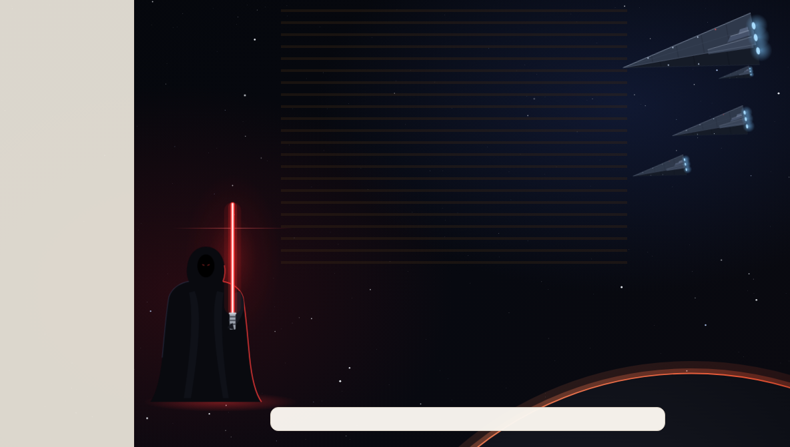

# looks

Switchable looks for the Claude desktop and mobile apps. A look is a color theme plus an optional moving backdrop. The terminal and editor extensions do not draw looks.

## Switch

- `/custom-theme` lists every theme, numbered, and marks the one in use.
- `/custom-theme pixel-cats` or `/custom-theme 2` switches by name or number.
- `/custom-theme next` goes to the next theme in the list, then to off.
- `/custom-theme off` returns to the app's own theme.
- `/look` is a short form of `/custom-theme` and takes the same words.

The last theme you pick is saved in `~/.claude/looks-choice.json`. Every chat follows it: new chats start with it, and open chats switch within a few seconds. Until you pick one, Pixel cats is used.

## Add a look

1. Copy `hooks/looks/cosmos.ts` to `hooks/looks/<id>.ts`. Change the colors, the scene SVG and the exported `Look` (`id`, `label`, `description`, scene name).
2. Import it in `hooks/looks/index.ts` and add it to `LOOKS`.
3. Run `claude plugin validate .` and `claude plugin test .`, then `/reload-plugins` in a terminal session, or start a new session.

Keep each scene SVG under 131,072 characters. For low CPU use, avoid blur filters and use `steps()` timing on slow animations.

## Themes

| # | Name | Look |
| --- | --- | --- |
| 1 | `cosmos` | Dark. A tilted black hole and a turning spiral galaxy over cyan, violet and ember nebulae. |
| 2 | `pixel-cats` | Light. Pixel art of two fluffy cats, Pixel and Charlie, in a sunny room. |
| 3 | `dark-fleet` | Dark and cinematic. A hooded warrior with a red energy blade, a wedge-shaped fleet and a moon-sized battle station. |
| 4 | `neon-tokyo` | Dark. Pixel-art Tokyo at night: the Skytree across a full moon, Mt Fuji, the lit Tokyo Tower, neon katakana signs, the tail of a departing train, a scramble crossing, a cherry tree with red lanterns, and a cat on a vending machine. |

### Cosmos


### Pixel cats


### Dark fleet



### Neon Tokyo


## T3 Code

`t3/` turns each look into a T3 Code theme. T3 themes are colors only, so the moving scenes stay in the Claude apps.

- `node t3/build.mjs` writes `t3/themes/<id>.json` from `LOOKS`.
- `node t3/look.mjs [name | number | next | off]` works like `/custom-theme`. It sets the pick as T3's environment theme (`t3 theme set`), so every T3 window switches, and new windows start with it. `off` sets T3 Chat, T3's own theme. Each switch rebuilds the files first.
- `/t3-theme` (the skill in `~/.claude/skills/t3-theme`) runs it from a chat.

## Install

At the prompt of a Claude Code terminal session:

```
/plugin install looks --marketplace markimoo09/claude-code-themes
```

From a shell:

```bash
claude plugin install looks --marketplace markimoo09/claude-code-themes
```

In the desktop app, where `/plugin` does not run: click + next to the prompt box, then Plugins, Add marketplace with `markimoo09/claude-code-themes`, then Add plugin.

### From a local copy

```bash
claude plugin marketplace add ~/Documents/Code/claude-looks
```

```bash
claude plugin install looks@local-looks
```

A plugin installed from a local folder is read from that folder, so edits there are what the app runs after `/reload-plugins` or a new session.
