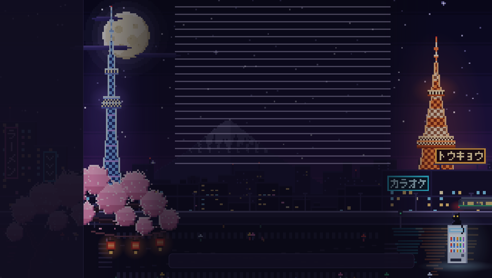
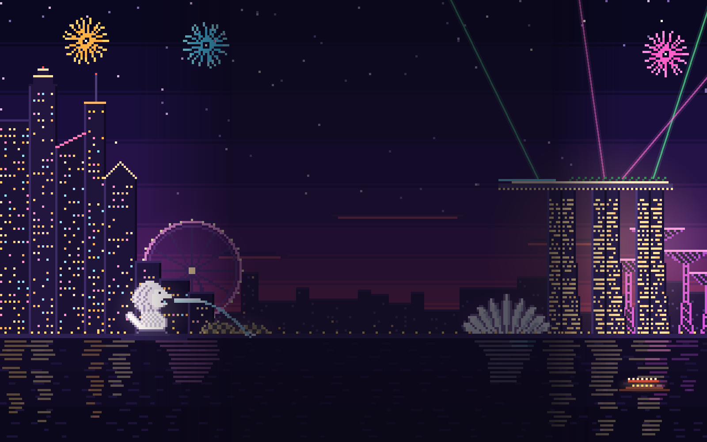
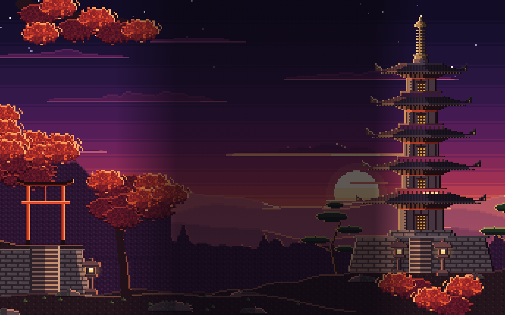
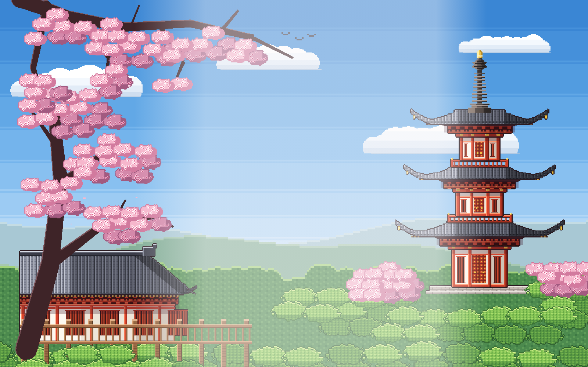
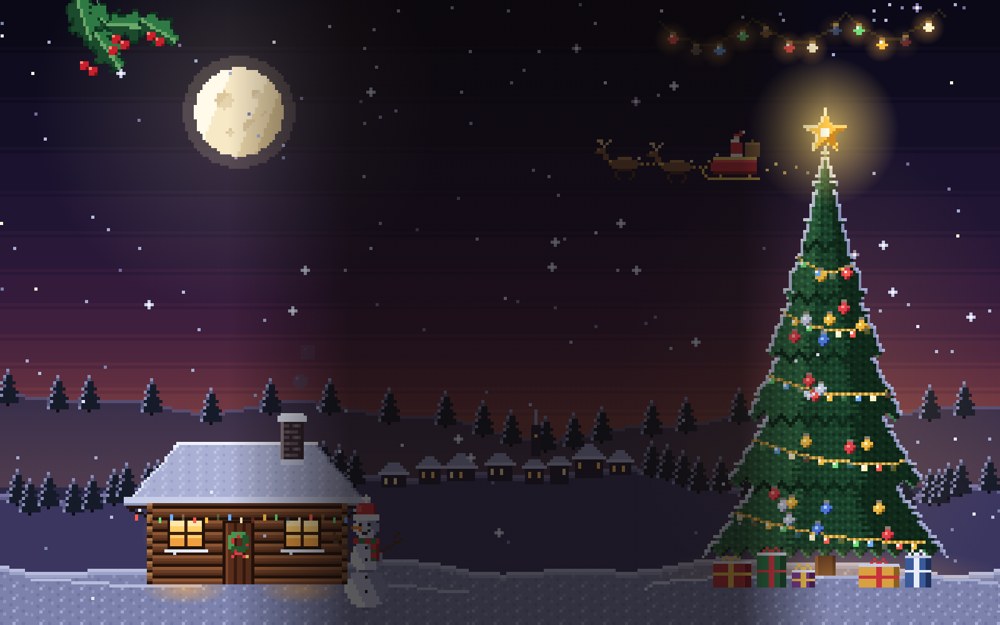

# looks

Switchable looks for the Claude desktop and mobile apps. A look is a color theme plus an optional moving backdrop. The terminal and editor extensions do not draw looks.

## Switch

- `/custom-theme` lists every theme, numbered, and marks the one in use.
- `/custom-theme pixel-cats` or `/custom-theme 2` switches by name or number.
- `/custom-theme next` goes to the next theme in the list, then to off.
- `/custom-theme off` returns to the app's own theme.
- `/look` is a short form of `/custom-theme` and takes the same words.

The last theme you pick is saved in `~/.claude/looks-choice.json`. Every chat follows it: new chats start with it, and open chats switch within a few seconds. Until you pick one, Pixel cats is used.

## Add a look

1. Copy `hooks/looks/cosmos.ts` to `hooks/looks/<id>.ts`. Change the colors, the scene SVG and the exported `Look` (`id`, `label`, `description`, scene name).
2. Import it in `hooks/looks/index.ts` and add it to `LOOKS`.
3. Run `claude plugin validate .` and `claude plugin test .`, then `/reload-plugins` in a terminal session, or start a new session.

Keep each scene SVG under 131,072 characters. For low CPU use, avoid blur filters and use `steps()` timing on slow animations.

## Themes

| # | Name | Look |
| --- | --- | --- |
| 1 | `cosmos` | Dark. A tilted black hole and a turning spiral galaxy over cyan, violet and ember nebulae. |
| 2 | `pixel-cats` | Dark and cozy. Pixel art of two fluffy cats at home at night: Pixel sitting by his yarn in front of a bookshelf lit by a lamp, under a hanging plant; Charlie loafing on top of a cat tree by a moonlit window, her tail over the edge; fairy lights, framed pictures and a round rug. |
| 3 | `dark-fleet` | Dark and cinematic. A hooded warrior with a red energy blade, a wedge-shaped fleet and a moon-sized battle station. |
| 4 | `neon-tokyo` | Dark. Pixel-art Tokyo at night: the Skytree across a full moon, Mt Fuji, the lit Tokyo Tower, neon katakana signs, the tail of a departing train, a scramble crossing, a cherry tree with red lanterns, and a cat on a vending machine. |
| 5 | `marina-bay` | Dark. Pixel-art Singapore at night across Marina Bay: Marina Bay Sands with its SkyPark and a laser show, the Merlion spouting into the bay, the Downtown Core and the Singapore Flyer, the glowing Supertrees, the ArtScience Museum's lotus, a bumboat and fireworks. |
| 6 | `kyoto-sunset` | Dark. Pixel-art Kyoto at sunset: a towering five-storey pagoda, its tiled eaves, brackets, railings and bronze spire lit by a low sun, on a stone terrace with steps and lanterns; stone steps up a wall to a vermilion torii under big red maples, with rocks and pines; ridgelines fading into haze over a forested valley, clouds lit from below, drifting leaves and birds crossing. |
| 7 | `kyoto-sakura` | Light. Pixel-art Kyoto in spring on a clear day: a vermilion three-storey pagoda with white plaster, gold accents, dark upturned eaves and a tall spire among spring-green trees and cherries; cherry branches dense with pale pink blossom arching in from the top and up the left side over a temple roof and a wooden railing; a forested hill, soft white clouds and drifting petals. |
| 8 | `christmas-eve` | Dark and warm. Pixel-art Christmas eve on a snowy night: a tall fir heavy with snow, wrapped in gold garland and twinkling bulbs, hung with baubles, a glowing star on top and presents at its foot; a log cabin under a thick roof of snow with icicles, firelit windows, a wreath on the door and smoke from its chimney, a snowman in a striped scarf in front; a full moon, a sleigh crossing the sky now and then, snowy hills, pines and a village of lit windows, falling snow, holly and a strand of big bulbs in the top corners. |

### Cosmos


### Pixel cats


### Dark fleet


### Neon Tokyo



### Marina Bay



### Kyoto sunset



### Kyoto sakura



### Christmas eve



## T3 Code

`t3/` turns each look into a T3 Code theme: its colors, and its moving scene behind the chat with a frosted panel behind the chat column so text stays readable.

- `node t3/build.mjs` writes `t3/themes/<id>.json` from `LOOKS`.
- T3 caps a theme's CSS at 50,000 characters and centers the chat in a column, so each scene has a T3 version in `t3/scenes/<id>.mjs`. It takes the original scene's SVG, makes it smaller, and moves the main subjects into the margins beside the column. A new look with no T3 version gets colors only if its scene is too big. `t3/lib.mjs` describes the layout.
- `node t3/preview.mjs <id>` checks the size and renders stills: the original, the T3 scene, and the T3 layout at full width and with the sidebar open.
- `node t3/look.mjs [name | number | next | off]` works like `/custom-theme`. It sets the pick as T3's environment theme (`t3 theme set`), so every T3 window switches, and new windows start with it. `off` sets T3 Chat, T3's own theme. Each switch rebuilds the files first.
- `/t3-theme` (the skill in `~/.claude/skills/t3-theme`) runs it from a chat, and also sets T3's light or dark mode to match the look.

## Install

At the prompt of a Claude Code terminal session:

```
/plugin install looks --marketplace markimoo09/claude-code-themes
```

From a shell:

```bash
claude plugin install looks --marketplace markimoo09/claude-code-themes
```

In the desktop app, where `/plugin` does not run: click + next to the prompt box, then Plugins, Add marketplace with `markimoo09/claude-code-themes`, then Add plugin.

### From a local copy

```bash
claude plugin marketplace add ~/Documents/Code/claude-looks
```

```bash
claude plugin install looks@local-looks
```

A plugin installed from a local folder is read from that folder, so edits there are what the app runs after `/reload-plugins` or a new session.
