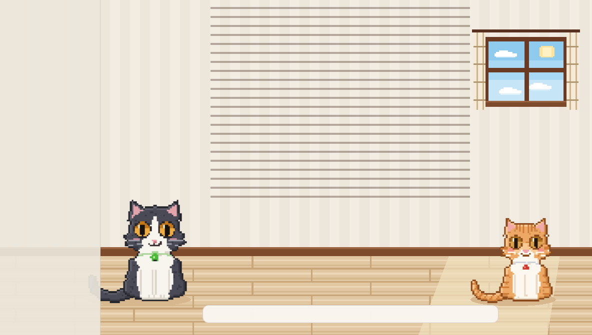

# looks

Switchable looks for the Claude desktop and mobile apps. A look is a color theme plus an optional moving backdrop. The terminal and editor extensions do not draw looks.

## Switch

- `/custom-theme` lists every theme, numbered, and marks the one in use.
- `/custom-theme pixel-cats` or `/custom-theme 2` switches by name or number.
- `/custom-theme next` goes to the next theme in the list, then to off.
- `/custom-theme off` returns to the app's own theme.
- `/look` is a short form of `/custom-theme` and takes the same words.

The last theme you pick is saved, and every new session starts with it. Until you pick one, Pixel cats is used.

## Add a look

1. Copy `hooks/looks/cosmos.ts` to `hooks/looks/<id>.ts`. Change the colors, the scene SVG and the exported `Look` (`id`, `label`, `description`, scene name).
2. Import it in `hooks/looks/index.ts` and add it to `LOOKS`.
3. Run `claude plugin validate .` and `claude plugin test .`, then `/reload-plugins` in a terminal session, or start a new session.

Keep each scene SVG under 131,072 characters. For low CPU use, avoid blur filters and use `steps()` timing on slow animations.

## Themes

| # | Name | Look |
| --- | --- | --- |
| 1 | `cosmos` | Dark. A tilted black hole and a turning spiral galaxy over cyan, violet and ember nebulae. |
| 2 | `pixel-cats` | Light. Pixel art of two fluffy cats, Pixel and Charlie, in a sunny room. |



## Install

At the prompt of a Claude Code terminal session:

```
/plugin install looks --marketplace markimoo09/claude-code-themes
```

From a shell:

```bash
claude plugin install looks --marketplace markimoo09/claude-code-themes
```

In the desktop app, where `/plugin` does not run: click + next to the prompt box, then Plugins, Add marketplace with `markimoo09/claude-code-themes`, then Add plugin.

### From a local copy

```bash
claude plugin marketplace add ~/Documents/Code/claude-looks
```

```bash
claude plugin install looks@local-looks
```

A plugin installed from a local folder is read from that folder, so edits there are what the app runs after `/reload-plugins` or a new session.
